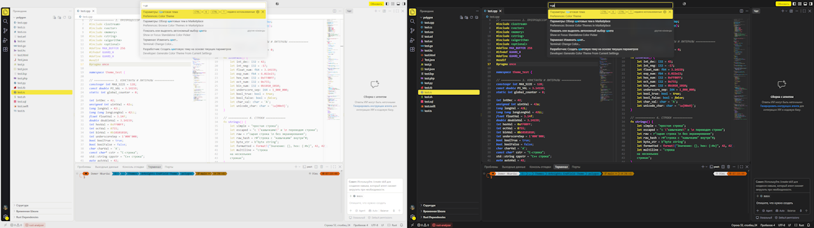
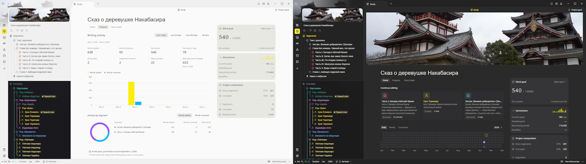

# “Arknights: Endfield” Inspired Themes

I really liked the user interface design of Arknights: Endfield, including its color palette. It inspired me to create color themes for several applications, featuring both light and dark variants.

## [VS Code](/vscode/)

## [Writality](/writality/)

# Disclaimer
A fan-made theme inspired by Arknights: Endfield. Not affiliated with, endorsed by, or sponsored by Hypergryph. All trademarks are the property of their respective owners.

---

